# DevTape & DTP v0.1

[](https://github.com/sayyidsh/devtape/actions/workflows/ci.yml)
[](https://github.com/sayyidsh/devtape/releases/tag/v0.4.7)
[](https://sayyidsh.github.io/devtape/)
[](LICENSE)

**DevTape** is the reference Rust implementation of the **DevTape Protocol (DTP v0.1)** — an open, local-first protocol for recording, scrubbing, rewinding, and inspecting developer and AI-agent execution sessions in a single portable `.tape` archive (`spec/RFC-0001-dtp-v0.1.md` & `spec/dtp_v1.proto`).

- **Try the Zero-Install Timeline Viewer (with WASM `.tape` decoder):** **[https://sayyidsh.github.io/devtape/](https://sayyidsh.github.io/devtape/)** *(drag-and-drop any `.tape` file or click **"Load Sample Failing Tape"** to scrub through a demo session immediately in your browser)*



---

## Install

```sh
# Install via Homebrew Tap (macOS Apple Silicon / Intel & Linux prebuilt tarballs)
brew install sayyidsh/tap/devtape

# Or install from source via Cargo
cargo install --git https://github.com/sayyidsh/devtape devtape-cli

# Or download the prebuilt macOS Apple Silicon binary directly from GitHub Releases
curl -fsSL https://github.com/sayyidsh/devtape/releases/download/v0.4.7/devtape-aarch64-apple-darwin.tar.gz | tar -xz && chmod +x devtape
```

## 3-Step Quickstart

```sh
# 1. Record a command or interactive shell (with automatic secret scrubbing & Git shadow snapshot)
devtape record --out session.tape -- cargo test

# 2. Export a privacy-reviewed diff-only archive or standalone HTML report for a GitHub Issue or PR
devtape export <SESSION_ID> --profile diff-only --review --out bug-report.tape
devtape export <SESSION_ID> --profile full --format html --out bug-report.html

# 3. Inspect live sessions, diff/search archives, open the Timeline UI, or serve MCP tools
devtape ps
devtape tail --latest --follow
devtape diff pass.tape fail.tape
devtape search "FAILED" session.tape
devtape view session.tape
devtape mcp --tape session.tape
```

## GitHub Action (`devtape-action` — Automatic Failing CI `.tape` Artifacts)

Wrap any CI test or build step in 4 lines of YAML to automatically record `ext.ci.v1` context, export a scrubbed `--profile diff-only` `.tape` archive on failure, and attach it to the workflow run with a direct link to the browser viewer:

```yaml
- name: Run tests with DevTape failure capture
  uses: sayyidsh/devtape@v0.4.7
  with:
    command: cargo test --workspace
```

---

## Architecture Overview

Recording uses a dedicated PTY hot-path reader thread (`< 2 ms` passthrough budget) with a `16 MiB` byte-bounded backpressure queue (`QoS-0 ZeroStall` emits normative `DropMarker` events under flood bursts) and streaming 128-byte sliding-window secret redaction (`OverlapScrubber`). Archives carry HLC-ordered causal events, a `RedactionAttestation` manifest, and a canonical Blake3 integrity hash. Events stream live into SQLite (`PRAGMA journal_mode=WAL`) during active sessions via `RecordSink` and the Single-Writer WAL actor (queryable mid-session via `devtape ps` and `devtape tail --follow`), and sessions can be compared (`devtape diff`), searched (`devtape search`), exported by privacy profile (`full`, `diff-only`, `trace-only`) to `.tape` or self-contained `.html` reports (`--format html`), inspected through read-only MCP stdio tools, or viewed locally. Git shadow snapshots use an isolated temporary `GIT_INDEX_FILE` + FastCDC content-addressed storage, and `devtape rewind` automatically creates a `pre-rewind` safety snapshot before modifying the working tree.

## Workspace Crates (`#![forbid(unsafe_code)]`)

- `dtp-codec`: `DTAP01` container encoding, 1:100 decompression-bomb guard, HLC, event types, and stateful replay ANSI filtering (`OSC 52` stripping).
- `devtape-scrub`: Streaming secret scrubbing with sliding-window overlap and `<DTP:REDACTED:KIND:hash6>` placeholders.
- `devtape-pty`: Cross-platform PTY capture, byte-bounded QoS backpressure, and live `RecordSink` streaming.
- `devtape-git`: Non-destructive shadow snapshots, FastCDC CAS, `rewind`, and `undo-rewind`.
- `devtape-core`: Single-writer SQLite WAL session store (with live mid-session streaming, `ps`/`tail` runtime heartbeats, `diff`, and `search`) and privacy-profile exporter.
- `devtape-mcp`: Read-only JSON-RPC 2.0 MCP stdio tools (`tape_summary`, `tape_get_failures`, `tape_get_diff`, `tape_search_logs`).
- `devtape-net`: Opt-in child-only loopback HTTP & HTTPS (`CONNECT` MITM) capture proxy (`--net`) with ephemeral `rcgen` session CA, dynamic per-host leaf certificates, `Transfer-Encoding: chunked` request body capture + split-chunk secret redaction, and 1 MiB body truncation.
- `devtape-ui`: Loopback-only (`127.0.0.1`) read-only timeline server (Viewer v2 with Timeline, HTTP, Git, and CI tabs) and standalone offline HTML report generator.
- `dtp-wasm`: Per-span/channel incremental ANSI replay sanitizer and `wasm32-unknown-unknown` `.tape` browser decoder.
- `devtape-cli`: Reference `devtape` command-line interface (`4.77 MiB` stripped release binary).

## Full CLI Reference

```sh
devtape doctor
devtape demo-tape --out sample.tape
devtape inspect sample.tape
devtape record --out session.tape --qos zero-stall --db sessions.db -- sh -c 'echo hello'
devtape record --net --out network.tape -- curl https://example.com/
devtape ps --db sessions.db --json
devtape tail --latest --follow --filter pty --db sessions.db
devtape diff pass.tape fail.tape --json
devtape search "502|503" network.tape --regex --stream http --json
devtape snapshot --repo . --label before-change
devtape rewind --repo . --to SNAPSHOT_ID
devtape undo-rewind --repo .
devtape sessions --db sessions.db
devtape export SESSION_ID --db sessions.db --profile full --review --out exported.tape
devtape export SESSION_ID --db sessions.db --profile diff-only --review --out diff.tape
devtape export SESSION_ID --db sessions.db --profile trace-only --review --out trace.tape
devtape export SESSION_ID --db sessions.db --profile full --format html --out report.html
devtape view session.tape --port 0
devtape mcp --tape session.tape
printf 'Bearer example-token\n' | devtape scrub-check
```

`view` prints a loopback URL (`http://127.0.0.1:<port>`) and runs until interrupted. It sanitizes dangerous terminal control sequences for display; its displayed integrity hash is that of the original archive. `crates/devtape-ui/index.html` (also hosted at [https://sayyidsh.github.io/devtape/](https://sayyidsh.github.io/devtape/)) includes a one-click sample failing session, displays JSON exports locally, and decodes binary `.tape` files natively in the browser via the compiled `dtp-wasm` WebAssembly module.

`--net` captures both plain HTTP and decrypted HTTPS (`CONNECT` TLS termination via `tokio-rustls` + dynamic per-host leaf certificates signed by the session's ephemeral `rcgen` CA) as well as `Transfer-Encoding: chunked` request bodies via a child-only loopback proxy (`127.0.0.1:0`) without modifying the host environment or system trust store.

## Verification

```sh
CARGO_INCREMENTAL=0 cargo fmt --all -- --check
CARGO_INCREMENTAL=0 cargo clippy --workspace --all-targets -- -D warnings
CARGO_INCREMENTAL=0 cargo test --workspace
```

## License

Apache-2.0. The protocol specification in `spec/` is open and vendor-neutral.

## SDKs & Language Bindings

- **Rust (`dtp-codec`)**: use the workspace codec to decode and validate DTP archives.
- **JavaScript / TypeScript (`devtape-dtp-wasm`)**: initialize the WebAssembly decoder and call `decodeTape(bytes)`; see [the npm package guide](packages/dtp-wasm/README.md).
- **Python (`devtape-dtp`)**: use `decode_tape_json` and `sanitize_ansi`; see [the Python binding guide](bindings/python/README.md).

The SDK source is included here; package publication is a separate release step.
